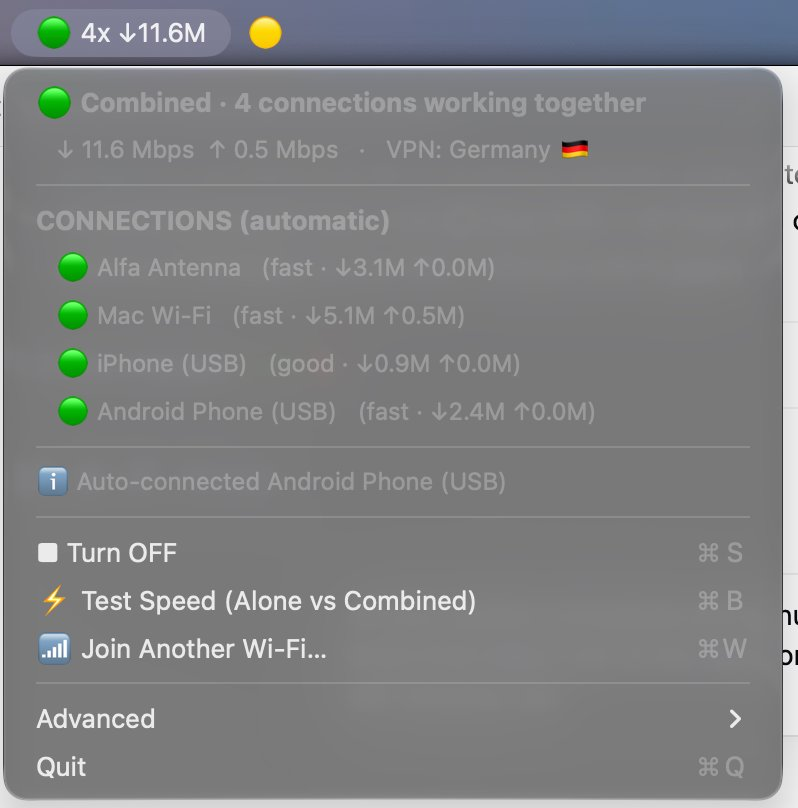

# Open Speedify (`speedbond`)

Open-source, self-hosted **multi-link QUIC bonding VPN** for macOS + Linux VPS. Combine **multiple Wi-Fi networks, phones (iPhone & Android), long-range USB Wi-Fi antennas, and Ethernet** into a single encrypted VPN connection with one stable public IP—for faster speeds and drop-resistant calls.

<p align="center">
  
</p>

```text
                 ┌── QUIC DATAGRAM over Mac Wi-Fi (en0) ───────────┐
                 ├── QUIC DATAGRAM over Alfa USB Antenna (VM UDP) ─┼── Your Linux VPS ── Internet
macOS (utun) ────┼── QUIC DATAGRAM over iPhone USB (enX) ──────────┤   (one stable VPN IP)
                 ├── QUIC DATAGRAM over Android USB (feth50) ──────┤
                 └── QUIC DATAGRAM over Ethernet / Nth link ───────┘
```

## What Connections Can You Combine?

You can combine **as many internet sources as you have** simultaneously:

- **Multiple Wi-Fi networks (1 per Wi-Fi card):** Connect your MacBook's built-in Wi-Fi to Network #1 (e.g. a phone hotspot or router) and an external USB Wi-Fi adapter—such as the **Alfa AWUS1900 on Apple Silicon** via [alfa-awus1900-apple-silicon](https://github.com/eminogrande/alfa-awus1900-apple-silicon)—to Network #2. Add more USB Wi-Fi cards for more Wi-Fi networks.
- **Multiple Phones over USB:**
  - **iPhone:** Plug in via USB and turn on **Personal Hotspot → Allow Others to Join**. *(Note: iOS only shares cellular data over USB, never Wi-Fi.)*
  - **Android (Samsung, Pixel, etc.):** Plug in via USB, enable **USB Tethering**, and use [`rndis-tether`](https://github.com/stlk0/rndis-tether) on macOS. Android shares **cellular data** when Wi-Fi is off, **or** can even share a **3rd Wi-Fi network** over USB when its Wi-Fi is on.
- **USB Ethernet / Starlink / Secondary Bridges:** Any active IPv4 interface or remote `speedbond bridge` UDP endpoint joins automatically.

> **Tip (Speed vs. Redundancy):** Combining connections from **different ISPs** (e.g., Wi-Fi router + cellular phone + second hotspot) **adds their speeds together** and survives a full ISP outage. Putting two links on the **same** router gives local antenna failover without exceeding that router's ISP cap.

## How Close Is This to Speedify?

| Capability | Status | Details |
|---|---|---|
| Combine N links (Wi-Fi + Alfa + iPhone + Android + Ethernet) | **Working & Proven** | Tested live with **4 simultaneous links** (`4/4 UP`). |
| Zero-HOL flow-sticky + MinRTT backpressure spillover | **Working & Proven** | Spreads concurrent streams cleanly across all links (`Reordered: 0`, `Gaps: 0`), spills bursts across remaining links, and never lets a slow/laggy link block fast ones. |
| Seamless link failover (keep calls & VPN IP alive) | **Working & Proven** | All traffic exits through your VPS IP. Killing the primary link mid-stream produced **12/12 pings (0.0% loss)** with zero IP change. |
| One-click ON/OFF macOS menu bar app + background autopilot | **Working & Proven** | `SpeedbondBar.app` auto-joins newly plugged phones/Ethernet, auto-heals Alfa USB after Mac sleep, auto-refreshes routes on Wi-Fi switch, and includes a nearby Wi-Fi picker. |
| Built-in Solo vs. Combined Speed Proof | **Working & Proven** | `speedbond bench` (and **⚡ Test Speed** in the menu bar) isolates each link solo, then measures all combined. |
| Live multi-ISP speedup proof | **Proven (+78.3% / 100% sum)** | `alfa` solo `0.59 Mbps` + `en0` solo `0.75 Mbps` → **combined `1.34 Mbps` (+78.3% vs best solo, 100% of combined sum)**; Alfa + iPhone live **`7.18 Mbps`**; 3-link TX peak **`9.97 Mbps`**. |
| Redundant / FEC packet-duplication mode | **Not yet** | Clean failover keeps calls connected; a sudden silent cable yank waits for QUIC's ~5–10s idle timeout unless packet duplication is added later. |
| IPv6 tunneling | **Not yet** | IPv4 tunnel only. |

## Verified Real-World Proof

1. **Live Solo vs. Combined Download Proof (`speedbond bench`, two independent public IPs):**
   ```text
   SOLO   alfa            0.59 Mbps  (0.59 MB in 8s)
   SOLO   en0             0.75 Mbps  (0.75 MB in 8s)
   BONDED alfa+en0        1.34 Mbps  (1.34 MB in 8s)

   PROOF: best solo=0.75 Mbps | sum=1.34 Mbps | bonded=1.34 Mbps (+78.3% vs best solo, 100% of combined sum)
   ```
   Live bonded peak during download: **`1.51 Mbps` RX** (`alfa` `1.01 Mbps` + `en0` `0.51 Mbps`), **`Reordered: 0`, `Gaps: 0`**.
2. **Live 4-Link Simultaneous Bonding (`4/4 UP`: Mac Wi-Fi + Alfa Antenna + Samsung Android USB + iPhone SE USB):**
   ```text
   Status: ON  Tunnel: utun5 (10.77.0.9)  Links: 4/4 up  Delivered: 132990  Reordered: 0  Gaps: 0
   en0     UP  22%  201.1ms  0.0%  TX 1.07 Mbps  (Mac Wi-Fi)
   alfa    UP  54%  184.3ms  0.0%  TX 2.44 Mbps  (Alfa Antenna)
   feth50  UP  23%  190.4ms  0.0%  TX 1.12 Mbps  (Android Phone USB)
   en9     UP   1%  backup   0.0%                (iPhone SE USB)
   ```
   Also observed live:
   - **Alfa + iPhone USB combined:** **`7.18 Mbps` TX** (`alfa` `5.79 Mbps` + `iPhone en9` `1.39 Mbps`, `323ms`, `0.0%` loss, `731,298` packets delivered, `0` gaps).
   - **3-link peak upload:** **`9.97 Mbps` TX** (`alfa` `6.88` + `en0` `2.83` + `feth50` `0.26`).
3. **Live Mid-Stream Failover Proof:**
   - Continuous `ping -c 12 -i 0.5 1.1.1.1` through the tunnel while pausing primary link (`alfa`) mid-stream and resuming 3s later: **`12/12 received, 0.0% packet loss`**, VPN exit IP remained unchanged on the VPS.
4. **Automated Race-Detector Tests (`go test -count=1 -race ./...`):**
   - `TestReassemblerOrdersAndSkipsLostPackets` (incl. late-packet delivery + duplicate suppression) — PASS
   - `TestTwoQUICLinksAndFailover` — PASS
   - `TestRelaySharedSessionReassemblyAndBridge` — PASS
   - `TestSmoothWeightedRoundRobin` — PASS

## Quick Start

### 1. Build Binaries (macOS + Linux VPS + optional ARM64 VM bridge)

Requires Go 1.24+:
```bash
go test -count=1 -race ./...
go build -o speedbond .
GOOS=linux GOARCH=amd64 go build -o speedbond-linux .    # Ubuntu x86_64 VPS relay
GOOS=linux GOARCH=arm64 go build -o speedbond-arm64 .    # ARM64 VM UDP bridge (e.g. Alfa VM)
```

### 2. Deploy Relay on Your Linux VPS (Ubuntu)

Needs `/dev/net/tun`, `ip`, and `iptables`. Open UDP port `443` (or your chosen port):
```bash
sudo install -m 755 speedbond-linux /usr/local/sbin/speedbond
sudo mkdir -p /etc/speedbond
sudo /usr/local/sbin/speedbond cert -cert /etc/speedbond/relay.crt -key /etc/speedbond/relay.key
# Save the printed SHA-256 certificate pin for your Mac client!
```
Create `/etc/speedbond/environment` with `SPEEDBOND_TOKEN=<random 32+ char secret>`, install [speedbond-relay.service](speedbond-relay.service), and start it:
```bash
sudo systemctl enable --now speedbond-relay
```
The relay automatically configures its TUN interface (`MTU=1150`), IPv4 forwarding, NAT masquerading, and TCP MSS clamping.

### 3. macOS Menu Bar App (`SpeedbondBar.app`) — Recommended

Build and launch the native autopilot menu bar app:
```bash
mkdir -p SpeedbondBar.app/Contents/MacOS
swiftc -O -swift-version 5 -framework Cocoa -framework CoreWLAN SpeedbondBar.swift \
  -o SpeedbondBar.app/Contents/MacOS/SpeedbondBar
open SpeedbondBar.app
```
From the menu bar (`⚪ Bond OFF` → `🟢 Combined 2x` / `3x` / `4x`):
- **▶ Turn ON / ■ Turn OFF** — one click (Touch ID/password to start; instant no-password stop).
- **Automatic Discovery & Self-Healing** — automatically detects & joins Mac Wi-Fi, Alfa Antenna, iPhone USB, Android USB, and Ethernet; auto-heals Alfa USB after Mac sleep; auto-refreshes routes when you switch Wi-Fi networks; and keeps macOS SOCKS5 proxy off while bonded so browsers use your VPS VPN IP.
- **📶 Join Another Wi-Fi…** — scans nearby Wi-Fi networks and connects Mac Wi-Fi or Alfa Antenna to a 2nd Wi-Fi (asks for password only if not saved).
- **⚡ Test Speed (Alone vs Combined)** — plain-English proof right in the menu bar.
- **Advanced ▸** — tunnel details, manual pause/resume, custom link specs, Android USB repair, and terminal TUI (`bond`).

### 4. Terminal Launcher, TUI (`bond`), and CLI

```bash
./start-bond.sh                                          # Auto-detect all links & start client
./speedbond-tui.py                                       # Live terminal TUI (or symlink as `bond`)

speedbond interfaces                                     # List active interfaces
speedbond probe -server VPS:443 -links en0,en9 -pin PIN  # Test links without root/routing changes
speedbond status                                         # Live per-link Mbps, RTT, loss, weights
speedbond ctl add feth50                                 # Hot-add link live
speedbond ctl pause en0                                  # Pause/resume link live
speedbond bench -seconds 8 -streams 3                    # Solo vs. Bonded speed proof
speedbond bridge -listen :4546 -target VPS:443 -iface wlx00c0caa826f5
```

### 5. Optional Hardware Companions

- **Alfa AWUS1900 Long-Range USB Wi-Fi on Apple Silicon Mac:** Set up with [eminogrande/alfa-awus1900-apple-silicon](https://github.com/eminogrande/alfa-awus1900-apple-silicon). `start-bond.sh` and `SpeedbondBar.app` automatically inject a live QEMU UDP port-forward (`127.0.0.1:4546`) and run `speedbond bridge` inside the Alfa VM bound directly to `wlx*`, with zero VM reboot and automatic sleep recovery.
- **Android USB Tethering on macOS:** macOS lacks built-in RNDIS support; install user-space [`rndis-tether`](https://github.com/stlk0/rndis-tether):
  ```bash
  brew install stlk0/tap/rndis-tether
  sudo rndis-tether install
  rndis-tether config prefer-phone no
  rndis-tether config tx-batch 1
  ```

## Source Layout

- `client.go`: multi-link manager, flexible link specs (`iface` & `name=host:port`), dynamic hot-add/remove/pause, automatic route refresh on Wi-Fi/subnet changes, loopback control API (`127.0.0.1:19454`).
- `relay.go`: shared per-session reassembly, flow-sticky downlink bonding, IP allocation (`10.77.0.0/16`), NAT forwarding.
- `pool.go`, `protocol.go`, `reorder.go`: zero-HOL flow-sticky + MinRTT backpressure spillover scheduler, `MTU=1150` framing, late-packet-safe optional reassembler.
- `bridge.go`: zero-dependency UDP interface bridge (used for Alfa QEMU VM `wlx*` passthrough or any secondary Linux/macOS host).
- `tun_darwin.go`, `tun_linux.go`: native TUN/utun, per-interface `-ifscope` default gateway routing on macOS, iptables NAT + TCP MSS clamping on Linux.
- `SpeedbondBar.swift`: native macOS menu bar autopilot app & nearby Wi-Fi picker.
- `speedbond-tui.py`: zero-dependency terminal TUI (`bond`).
- `start-bond.sh`: auto-detect launcher with live Alfa QEMU UDP bridge setup & sleep recovery.
